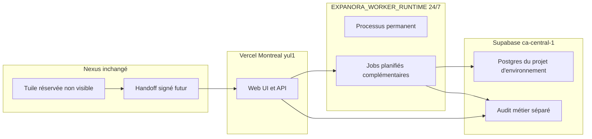

# EXPANORA — Architecture de déploiement V1

Architecture de déploiement validée. Elle ne rouvre pas l'architecture produit.

Aucun dépôt, aucun DNS, aucune base, aucun secret et aucun déploiement ne sont créés par cette validation.

```text
DELIVERABLE=EXPANORA_DEPLOYMENT_ARCHITECTURE_V1
GATE=EXPANORA-DEPLOYMENT-ARCHITECTURE-24X7-AMENDMENT
PRIOR_GATE=EXPANORA-DEPLOYMENT-ARCHITECTURE-VALIDATION
MODE=TARGETED_ARCHITECTURE_AMENDMENT_ONLY
DATE=2026-09-22
PROJECT=TAGORA_EXPANORA
DECIDEUR=Martin ST-Gelais — Direction
IMPLEMENTATION_AUTHORIZED=NO
STATUS=EXPANORA_24X7_RUNTIME_ARCHITECTURE_AMENDED
EXPANORA_DEPLOYMENT_ARCHITECTURE_V1_VALIDATED=YES
EXPANORA_24X7_RUNTIME_REQUIRED=YES
PRODUCT_ARCHITECTURE_REOPENED=NO
ADR_PRODUCT=ADR-0020
DEC_PRODUCT=DEC-032
VALD_PRODUCT=VALD-110
ADR_DEPLOYMENT=ADR-0021
DECISION=DEC-033
VALIDATION=VALD-111
VALIDATION_STATUS=VALIDE
LOCAL_PROJECT_PATH=C:\dev\TAGORA\tagora-expanora
REPO_CREATED=NO
DNS_CREATED=NO
DATABASE_CREATED=NO
SECRETS_CREATED=NO
PAID_SERVICE_ACTIVATED=NO
NEXUS_CHANGE_AUTHORIZED=NO
OTHER_MODULE_WRITE_AUTHORIZED=NO
```

Référence produit figée, non réouverte : [EXPANORA_ARCHITECTURE_V1.md](EXPANORA_ARCHITECTURE_V1.md).

---

## 1. Diagramme de déploiement

```text
Nexus (inchangé, tuile NON VISIBLE)
  handoff signé futur, audience tagora_expanora
        |
        v
+-------------- Vercel : Web UI + API ------------------+
| région d'exécution préférée : Montreal / yul1         |
| session | politique | pre-flight | Sandbox Lab        |
+---------------------------+---------------------------+
                            |
                            v
+--------- EXPANORA_WORKER_RUNTIME 24/7 cloud ----------+
| processus long-lived permanent                        |
| scouts | Web Intelligence | Opportunity Engine        |
| file | adapters | jobs planifiés complémentaires    |
| heartbeat | redémarrage | supervision               |
+---------------------------+---------------------------+
                            |
          +-----------------+------------------+
          v                 v                  v
 Supabase Postgres     Secrets hybrides    Canaux en lecture seule
 ca-central-1          env + coffre         WordPress écriture OFF
 projet dédié par env
```



Le Sandbox Lab reste un statut d'expérience. Une expérience `SANDBOX` ne sort pas vers un canal ni vers un module.

La région d'exécution Vercel, la région de stockage Supabase et la durée de rétention sont trois choix distincts. Leur réunion ne constitue pas, à elle seule, une conformité réglementaire.

---

## 2. Architecture applicative

| Runtime | Rôle | Décision |
|---|---|---|
| Web UI + API | Écrans, session, politique, modèle canonique, approbations, pre-flight, Sandbox Lab | Un livrable sur **Vercel**. Région d'exécution préférée **Montreal / yul1** |
| Growth Orchestrator | Mission dans l'API cloud | Disponible 24/7 avec l'API. Pas un second hôte |
| `EXPANORA_WORKER_RUNTIME` | Runtime cloud permanent | Long-lived, 24 heures sur 24, 7 jours sur 7 |
| Scouts, Web Intelligence, Opportunity Engine, file, adapters | Dans le runtime permanent | Les jobs planifiés et l'événementiel complètent. Ils ne le remplacent pas |
| Audit métier | Reconstruction des décisions | Table EXPANORA, distincte des logs techniques |
| Sandbox Lab | Statut sans écriture externe | Règle de l'API |

```text
WEB_API_PLATFORM=Vercel
PREFERRED_EXECUTION_REGION=Montreal / yul1
CLOUD_LIVE=24_HOURS_7_DAYS
EXPANORA_24X7_RUNTIME_REQUIRED=YES
EXPANORA_WORKER_RUNTIME=LONG_LIVED_CLOUD
SCHEDULED_AND_EVENT_DRIVEN_REPLACE_PERMANENT_RUNTIME=NO
LONG_LIVED_WORKER_HOST_LOCKED=NO
RAILWAY_LOCKED=NO
BROWSER_CALLS_WORKER_DIRECTLY=NO
PERMANENT_DAEMON_REQUIRED_IN_V1=REPLACED_BY_24X7_REQUIREMENT
```

L'ancienne règle « un worker continu n'est pas obligatoire » est remplacée. EXPANORA reste LIVE dans le cloud en permanence. Le Web, l'API et l'orchestrateur sont cloud. Le runtime de travail est un processus long-lived 24/7. Les jobs planifiés et les fonctions événementielles restent utiles. Ils ne remplacent pas ce runtime.

Le fournisseur du runtime permanent est choisi par VALD-112 : Google Cloud Run worker pools, Montréal. Aucune ressource n'est créée. Le coût n'est pas figé. Le code ne dépend pas d'un SDK Google.

Le runtime permanent prévoit : heartbeat, health checks, redémarrage automatique, supervision, surveillance d'uptime, logs structurés, métriques, alertes, retries bornés, santé de la file, santé du worker, santé des adapters, santé des fournisseurs IA, kill switch, isolation tenant/marque fail-closed.

---

## 3. URLs et Nexus

Réservation architecturale seulement. Aucun DNS et aucune route Nexus ne sont créés.

```text
PRODUCTION_RESERVED=expanora.tagora.ca
STAGING_RESERVED=expanora.staging.tagora.ca
NEXUS_ROUTE_RESERVED=/modules/expanora
NEXUS_TILE_VISIBLE=NO
DNS_CREATED=NO
NEXUS_ROUTE_CREATED=NO
ADR_0004_AMENDED=NO
CANONICAL_MODULE_KEY=tagora_expanora
```

LOCAL n'a pas de domaine public. Il reste sur la machine de développement.

La tuile reste non visible dans tous les environnements jusqu'à un gate explicite.

---

## 4. Environnements et base

Plateforme de données : **Supabase Postgres**, région de stockage **ca-central-1**.

| Environnement | Base | Séparation |
|---|---|---|
| LOCAL | Base de développement locale | Aucune donnée réelle |
| STAGING | Projet Supabase EXPANORA dédié | Projet distinct de Production |
| PRODUCTION | Projet Supabase EXPANORA dédié | Projet distinct de Staging |

```text
EXPANORA_DATABASE_PLATFORM=Supabase Postgres
DATABASE_REGION=ca-central-1
STAGING_PROJECT=DEDICATED
PRODUCTION_PROJECT=DEDICATED
STAGING_PRODUCTION_SEPARATED=YES
DATABASE_CREATED=NO
```

Staging et Production sont séparés physiquement ou logiquement : projets distincts, secrets distincts, kill switch distinct. Production n'est pas copiée vers Local ou Staging.

Promotion :

```text
LOCAL → artefact versionné → STAGING → gate humain → PRODUCTION
SKIP_STAGING=FORBIDDEN
```

Ce gate n'autorise aucune promotion et ne crée aucun projet Supabase.

---

## 5. Propriété des données

Toutes ces données appartiennent à EXPANORA, dans le projet Supabase de l'environnement. Aucune n'est une table d'un autre module.

| Donnée | Portée |
|---|---|
| Tenant / company | Une entreprise = un tenant |
| Brand | Exactement un tenant |
| Campagnes canoniques, opportunities, recommendations, approvals, experiments | Tenant + marque |
| Performance memory | Privée par tenant et marque |
| Web Intelligence | Provenance obligatoire |
| Audit métier | Append-only, séparé des logs techniques |
| Adapter state, capability registry | Manifeste versionné, activation par marque |
| Références et coffre de credentials | Valeur jamais dans un log |

`organization_id` Nexus peut être un lien d'accès. La clé d'isolation reste `tenant_id` + `brand_id`.

---

## 6. Isolation

Fail-closed. Un doute sur le tenant ou la marque arrête l'opération.

| Couche | Règle |
|---|---|
| Application | Requête sans tenant, ou marque absente, ambiguë ou d'un autre tenant : refus |
| Base | RLS Supabase : défaut refus. La session ne voit que son tenant, puis sa marque |
| `EXPANORA_WORKER_RUNTIME` | Chaque job revérifie la portée avant toute lecture externe |
| Adapters | Secret et compte résolus pour ce couple seulement |
| Contexte IA | Prompt filtré. Appel sans portée : pas d'appel |
| Cache | Préfixe `env:tenant:brand` |
| Logs techniques | Portée obligatoire. Pas de secret, pas de contenu client |
| Analytics | Filtre tenant obligatoire |

```text
ONE_COMPANY_ONE_TENANT=YES
ONE_BRAND_ONE_TENANT=YES
CROSS_TENANT=DENY
CROSS_BRAND=DENY
SILENT_SCOPE_CROSSING=FORBIDDEN
```

---

## 7. Sécurité des jobs

Chaque job de `EXPANORA_WORKER_RUNTIME` est :

- idempotent ;
- scopé tenant ;
- scopé marque lorsque le travail concerne une marque ;
- à retry borné ;
- à timeout borné ;
- observable ;
- audité ;
- budgété ;
- soumis au kill switch.

Une tâche qui ne peut pas prouver sa portée est refusée. Elle ne traverse pas un tenant ou une marque en silence.

Le runtime qui porte ces jobs est permanent. Son absence de heartbeat est une alerte, pas un mode nominal.

---

## 8. Secrets

Architecture hybride. Aucun secret n'est créé ici.

Secrets d'infrastructure et d'application :

- secrets d'environnement gérés par la plateforme ;
- jamais dans Git ;
- jamais exposés au frontend ;
- rotation et révocation possibles.

Credentials externes dynamiques, par tenant et par marque (Meta, Google, TikTok, LinkedIn, WordPress, analytics, fournisseurs IA, canaux futurs) :

- stockage chiffré côté backend ;
- `tenant_id` obligatoire ;
- `brand_id` lorsque le credential appartient à une marque ;
- accès limité aux services autorisés ;
- journalisation des accès, sans la valeur ;
- aucune valeur secrète dans les logs techniques ni dans l'audit métier.

```text
SECRET_BACKEND=SUPABASE_VAULT_OR_EQUIVALENT
VAULT_LOCK_IN=NO
SECRETS_IN_GIT=FORBIDDEN
SECRETS_IN_FRONTEND=FORBIDDEN
SECRETS_IN_LOGS=FORBIDDEN
CREDENTIAL_CREATED_NOW=NO
PILOT_CREDENTIAL_MODE=READ_ONLY
```

Supabase Vault est un mécanisme acceptable. Un équivalent peut le remplacer. Le choix n'est pas un verrou irréversible.

---

## 9. Observabilité

Deux familles, qui ne se confondent pas.

| Famille | Support V1 | Contenu |
|---|---|---|
| `TECHNICAL_LOGS` | Logs et métriques Vercel pour le Web/API. Logs et métriques Supabase pour la base et le backend. Suivi d'erreurs applicatif compatible Sentry, ou équivalent | Diagnostic technique. PII et contenus clients sensibles supprimés ou rédigés |
| `BUSINESS_AUDIT_TRAIL` | Table d'audit dans la base EXPANORA, séparée des logs techniques | Décisions métier reconstruites |

L'audit métier doit permettre de reconstruire : qui, quoi, quand, tenant, marque, agent, fournisseur, adapter, approbation, action, résultat, coût, raison du refus.

```text
TECHNICAL_LOGS_ARE_BUSINESS_AUDIT=NO
PII_REDACTION=REQUIRED
SENTRY_OR_EQUIVALENT=YES
SENTRY_VENDOR_LOCKED=NO
BUSINESS_AUDIT_STORE=EXPANORA_DATABASE
```

Le kill switch est visible dans les deux familles : état technique, et ligne d'audit qui dit qui l'a armé.

---

## 10. Résidence

Le Canada est favorisé lorsque le fournisseur le permet.

```text
EXECUTION_REGION_PREFERRED=Montreal / yul1
STORAGE_REGION=ca-central-1
RETENTION_POLICY=SEPARATE_DECISION
REGION_CHOICE_EQUALS_REGULATORY_COMPLIANCE=NO
```

La région d'exécution, la région de stockage et la politique de rétention se décident et se documentent séparément. Un choix de région ne suffit pas à déclarer une conformité réglementaire.

---

## 11. Adapters et recherche

Tous les canaux externes commencent en lecture seule. L'écriture WordPress reste désactivée par défaut. L'exécution passe par `EXPANORA_WORKER_RUNTIME`, pas par le navigateur.

```text
READ_ONLY=YES
WRITE=NO
WORDPRESS_WRITE=DISABLED_BY_DEFAULT
RESEARCH_BECOMES_PRODUCTION_CHANGE=NEVER
CAPABILITY_ABSENT_FAIL_CLOSED=YES
```

La recherche planifiée stocke provenance, dédoublonnage, crédibilité et fraîcheur dans EXPANORA. L'Opportunity Engine propose. Il ne publie pas et ne dépense pas.

---

## 12. Handoff Nexus

Gate futur spécifique. Nexus n'est pas modifié ici.

```text
FUTURE_HANDOFF_AUDIENCE=tagora_expanora
FUTURE_FLOW=NEXUS → signed handoff → EXPANORA → identity validation → tenant validation → brand access validation → module authorization
HANDOFF_IMPLEMENTED=NO
NEXUS_REPOSITORY_MODIFIED=NO
ADR_0010_AMENDED=NO
NEXUS_TILE_VISIBLE=NO
```

Le pattern reste TAGORA_HANDOFF_V1 : usage unique, audience liée à la clé, session locale, aucun cookie partagé, aucun secret dans le handoff.

---

## 13. Transport intermodules

EXPANORA n'écrit dans aucune base d'un autre module.

```text
EXPANORA
→ ACTION REQUEST signée
→ APPROVAL si requise
→ MODULE PROPRIÉTAIRE
→ EXECUTION
→ RESULT EVENT signé
→ EXPANORA
```

Transport prévu : HTTPS signé, quand un gate du module cible l'autorisera. PULS, MESSOR, Voice, DEPORA, YORVA, HORORA, ETIOQ et Nexus ne sont pas modifiés.

---

## 14. Échecs fail-closed

Aucun repli silencieux ne crée un faux succès.

| Code | Effet |
|---|---|
| `TENANT_MISMATCH` | Refus. Audit de sécurité. Pas de correction automatique |
| `BRAND_MISMATCH` | Refus. Pas de correction automatique |
| `AUTH_EXPIRED` | Adapter arrêté. Pas de réauthentification silencieuse |
| `CAPABILITY_ABSENT` | Appel non fait. Donnée non inventée |
| `APPROVAL_REQUIRED` | Demande parquée. Pas d'exécution |
| `BUDGET_BLOCKED` | Refus. Plafond non relevé par le runtime |
| `COMPLIANCE_BLOCKED` | Pre-flight refuse. La sortie ne part pas |
| `MARGIN_UNKNOWN` | Advisor peut montrer le trou. Autopilot interdit |
| `AUTOPILOT_FORBIDDEN` | Chemin autopilot refusé |

`PROVIDER_UNAVAILABLE` et `RATE_LIMITED` restent des échecs visibles après retry borné. Ils ne deviennent pas un succès.

---

## 15. Rollback, coûts, pilote

Le rollback d'un déploiement revient au couple Web/API et runtime de la version précédente, sur l'environnement concerné. Un adapter revient au manifeste précédent. Une expérience passe à `ROLLED_BACK`. En lecture seule, il n'y a pas d'effet externe à annuler.

Les compteurs de coût IA, de recherche et d'appels d'adapter vivent dans EXPANORA. Le dépassement refuse l'appel. Aucune dépense n'est autorisée.

Pilote futur, non autorisé maintenant :

```text
PILOT_SHAPE=ONE_TENANT + ONE_BRAND + ONE_WORDPRESS
PILOT_MODE=ADVISOR
PILOT_INTEGRATIONS=READ_ONLY
X_PLOD_STATUS=CANDIDATE_NOT_CONFIRMED
TILE_VISIBLE_FOR_PILOT=NO
```

---

## 16. Décisions de validation

| ID | Décision Martin | Statut |
|---|---|---|
| OD-DEP-01 | `expanora.tagora.ca`, `expanora.staging.tagora.ca`, route `/modules/expanora`. Rien n'est créé. Tuile non visible | Tranché |
| OD-DEP-02 | Web/API sur Vercel, Montréal / yul1. Amendé : runtime long-lived 24/7 exigé. Fournisseur du runtime non verrouillé. Railway non verrouillé | Tranché, puis amendé sur le 24/7 |
| OD-DEP-03 | Supabase Postgres `ca-central-1`. Projets Local, Staging dédié, Production dédié. Aucune base créée | Tranché |
| OD-DEP-04 | Secrets d'environnement gérés, plus coffre chiffré tenant/marque. Vault ou équivalent, sans verrou irréversible | Tranché |
| OD-DEP-05 | Logs Vercel et Supabase, erreurs type Sentry, audit métier séparé dans EXPANORA | Tranché |
| OD-DEP-06 | Handoff futur, audience `tagora_expanora`, avec validation identité, tenant, marque et module. Nexus inchangé | Tranché |

Suites explicites, non bloquantes : création DNS, création des projets Supabase, choix du fournisseur du runtime 24/7, gate Nexus de handoff, confirmation X-Plod, activation de dépense. Le runtime permanent est exigé. Seul son hébergeur reste à choisir.

---

## 17. Boundary

```text
CODE_AUTHORIZED=NO
REPO_CREATION_AUTHORIZED=NO
DEPLOYMENT_AUTHORIZED=NO
DATABASE_CREATION_AUTHORIZED=NO
DNS_AUTHORIZED=NO
SECRET_CREATION_AUTHORIZED=NO
PAID_SERVICE_ACTIVATION_AUTHORIZED=NO
STAGING_CHANGE_AUTHORIZED=NO
PRODUCTION_CHANGE_AUTHORIZED=NO
NEXUS_WRITE_AUTHORIZED=NO
OTHER_MODULE_WRITE_AUTHORIZED=NO
ADR_0020_REOPENED=NO
DEC_032_REOPENED=NO
VALD_110_REOPENED=NO
```

---

## Statut

**EXPANORA_24X7_RUNTIME_ARCHITECTURE_AMENDED** — Martin ST-Gelais, 2026-09-22. Le déploiement V1 reste validé. Seule la règle de runtime est remplacée : EXPANORA est LIVE 24/7, avec un `EXPANORA_WORKER_RUNTIME` long-lived. L'implémentation reste interdite.
